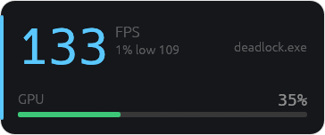
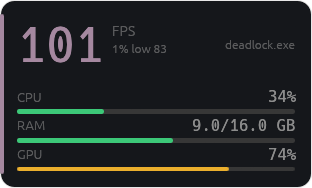
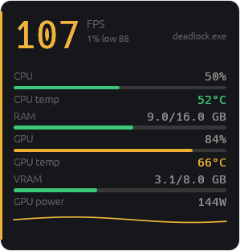
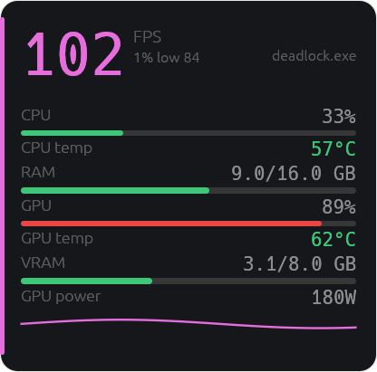

# minihud

A **headless Windows backend** that shows hardware stats and FPS:

1. **Hardware stats** — polls CPU / GPU / RAM sensors sourced entirely from
   [LibreHardwareMonitor](https://github.com/LibreHardwareMonitor/LibreHardwareMonitor) (LHM)
   and prints them on an interval.
2. **FPS** — reads the foreground target's FPS from **ETW present events** via a
   spawned `PresentMon.exe`. This is **tier 0**: no DLL injection, no game hook,
   nothing loaded into the target, so it is **anti-cheat-safe by construction**.

A bare run opens the **OSD overlay** — see [OSD overlay](#osd-overlay-default).
`--follow` and `--stats-only` select the headless console modes instead, which
print lines like:

```
CPU 12% 55C 45W 4200MHz | RAM 8192/16384MB | GPU 30% 60C 120W 1800x7000MHz | VRAM 4096/8192MB [AMD Ryzen 7 5800X / NVIDIA GeForce RTX 3070]  |  pid 23996: 84.3 fps  11.87 ms
```

## FPS capture: tiers and why ETW is the default

| Tool | FPS method | Injects? | Tier |
|---|---|---|---|
| PresentMon | ETW `Dxgkrnl` present events | no | 0 |
| EasyFPS | spawns PresentMon, parses stdout CSV | no | 0 |
| FpsOverlayer | ETW `DxgKrnl_Present` (event id 184) | no | 0 |
| **minihud (default / `--follow`)** | **ETW via the PresentMon subprocess** | **no** | **0** |
| MangoHud | in-process Vulkan layer | yes | 3 |

ETW observes the kernel's present events **out-of-process**, so no anti-cheat
that blocks injection can stop it. When an anti-cheat blocks the **ETW session**
itself, minihud degrades gracefully: it logs once, shows `--`, and keeps
running.

There are exactly **two poll flags**, each defaulting to **500 ms**:
`--hardware-poll <ms>` drives both the hardware status-line refresh and the LHM
bridge tick; `--fps-poll <ms>` drives **how often the fps line updates** — the
target is re-resolved and the line redrawn on that cadence. The fps figure is
the **average over a fixed 500 ms window**, decoupled from the poll, so a single
noisy frame never makes the number jump: `--fps-poll 50` refreshes a stable
500 ms average 20×/s instead of shrinking the window. `--stats` logs the
achieved updates-per-second.

---

## Hardware stats

minihud polls CPU / GPU / RAM sensors and prints one line per poll. Anything LHM
does not report prints as `--`, never a guess.

| Group | Fields (all optional except CPU load) |
|-------|----------------------------------------|
| CPU | load %, temperature, package power, average clock, name |
| RAM | used / total (MB) |
| GPU | load %, temperature, power, core / memory clock, core voltage, VRAM used / total, D3D-dedicated memory, name |

LHM is the only data source: CPU temperature and package power have no usable
user-mode alternative, so no fallback backends exist.

**How it works.** LHM is .NET-only, so a persistent PowerShell sidecar
(`tools/lhm/lhm-bridge.ps1`) hosts `LibreHardwareMonitorLib.dll` and emits one
JSON sensor dump per poll. Rust reads it on a dedicated thread — the main loop
never blocks on it and keeps the last good sample until it goes stale.

```text
powershell  lhm-bridge.ps1  ->  LhmFeed (thread)  ->  HwPoller  ->  stdout
   |              |
   |              +-- LibreHardwareMonitorLib.dll
   +-- stdin "\n" ticks, stdout JSON
```

Hardware stats refresh on the `--hardware-poll` cadence (default 500 ms). The same
value drives the LHM bridge tick: the sidecar reads on that interval. Each
`Update()` read costs ~92 ms of its own, so the effective sensor rate is bounded
by the read rather than the tick.

---

## Requirements

- Windows 10/11, x86-64
- Rust (MSVC toolchain)
- **.NET Framework 4.7.2** (for the LHM DLL, already present on most installs)
- Administrator rights for full CPU temp/power (SuperIO) and for the ETW fps
  session. The exe self-elevates at runtime; `MINIHUD_NO_ELEVATE=1` skips it.
- For the FPS row: `PresentMon.exe` staged next to the exe (`cargo xtask build`
  copies it from the committed `tools/presentmon/`; Intel PresentMon, MIT).
  Optional — without it fps only reads `--`.

## One-time DLL fetch

The LHM assembly is gitignored (~700 KB), pinned to 0.9.4:

```powershell
curl -L "https://www.nuget.org/api/v2/package/LibreHardwareMonitorLib/0.9.4" -o lhm.zip
Expand-Archive lhm.zip lhm-pkg
Copy-Item lhm-pkg\lib\net472\LibreHardwareMonitorLib.dll tools\lhm\
```

Without it the exe runs but every hardware value reads `--`.

## Build & run

```powershell
cargo xtask build            # build + stage assets next to target/debug/minihud.exe (includes the --gui overlay)
cargo xtask run              # build + stage, then run
cargo xtask build --release
cargo xtask dist             # assemble a shippable folder in dist/
cargo xtask clean            # clean target/ and dist/
```

`cargo xtask build` is what stages everything next to the exe so it resolves
assets from its own directory: `lhm-bridge.ps1`, `LibreHardwareMonitorLib.dll`,
and `PresentMon.exe` (the tier-0 ETW FPS sidecar; staged only when
`tools/presentmon/PresentMon.exe` is present). It also stages a default
`minihud.toml` (all defaults active, alternatives commented) when none exists;
an existing file is never overwritten. Plain `cargo build` compiles but
does not stage.

### Hardware stats

```powershell
target\debug\minihud.exe --stats-only   # live status line (updates in place); Ctrl+C to stop
```

### FPS console mode (tier 0)

`--follow` shows the foreground target's **fps/frametime** beside the
hardware stats on one self-updating line, read **out-of-process over ETW**.
Nothing is injected:

```powershell
target\debug\minihud.exe --follow               # follow the foreground target on the console
target\debug\minihud.exe --follow --match deadlock*.exe   # follow a target by name
target\debug\minihud.exe --follow-secs 30         # bounded run
target\debug\minihud.exe --fps-pid Overwatch      # explicit fps target
target\debug\minihud.exe --fps-poll 250           # fps refresh cadence in ms (average window is fixed at 500)
target\debug\minihud.exe --hardware-poll 1000     # hardware refresh + LHM bridge cadence in ms (default 500)
target\debug\minihud.exe --stats                  # log achieved updates-per-second
target\debug\minihud.exe --no-fps                 # hardware only
```

`fps: ETW (tier 0, no injection)` is logged at start. If an anti-cheat blocks
the ETW session, the fps reads `--` and the run keeps going.

## CLI reference

```text
minihud                                    show the OSD overlay (default)
minihud --stats-only                       print hardware stats only (no fps)
minihud --gui [--match <glob>] [--follow-secs <n>]
minihud --follow [--match <glob>] [--follow-secs <n>]
minihud -h | --help                        print help

<pid|name> is a numeric pid or a process image name (case-insensitive, `.exe`
optional): `Overwatch`, `overwatch.exe`, or `1234` all work.

FPS (tier 0, ETW, never injects):
--fps / --no-fps             enable / disable the ETW fps readout (default: on).
--fps-poll <n>               fps refresh cadence in ms (default 500): how often the readout
                             redraws and the target is re-resolved. The average is always over
                             a fixed 500 ms window.
--fps-pid <pid|name>         explicit fps target (default: the followed/foreground target).
--follow                     follow the foreground target (or --match) and show its fps via
                             ETW on the console. Ctrl+C to stop. Needs elevation (ETW).
--match <glob>               with --follow or --gui, target an exe by case-insensitive glob
                             instead of the foreground process (e.g. deadlock*.exe).
--follow-secs <n>            with --follow or --gui, stop after <n> seconds (default: until Ctrl+C).
--hardware-poll <n>          hardware-stats poll cadence in ms (default 500). One value drives
                             both the status-line refresh and the LHM bridge tick.
--stats                      log the achieved hw/fps updates-per-second once a second.
--stats-only                 print hardware stats only; never show fps.

MINIHUD_NO_ELEVATE=1         skip the UAC self-elevation (headless tests/diagnostics).
```

## OSD overlay (default)

A fully customizable on-screen display: a transparent, always-on-top,
**click-through** panel (built with `egui`/`eframe`) showing FPS plus CPU / GPU /
RAM. It opens on a bare run; `--follow` and `--stats-only` select the headless
console modes instead. The console keeps its live hardware + fps status line
while the overlay runs.

**RTSS-style auto show/hide.** With no pinned target (no `--match`, `--fps-pid`,
or `target` in `minihud.toml`), the overlay appears automatically when an app
renders through DirectX / Vulkan / OpenGL — detected out-of-process over ETW,
never injected — and never floats over the desktop. It stays up while that game
runs even when it loses focus or is minimized (the last fps freezes, as on
RTSS), follows another game that takes the foreground, and hides again when the
game exits. A pinned target keeps the overlay always visible, as before.

| Zen | Standard |
|---|---|
|  |  |

| Full — every field plus an fps sparkline | Full, magenta accent, large scale |
|---|---|
|  |  |

The screenshots use **demo mode**: `MINIHUD_DEMO=1 minihud --gui` feeds synthetic,
animated values, so you can preview the overlay — and its themes — without any
hardware or the LHM DLL.

```powershell
cargo xtask build            # includes the overlay; or: cargo build --features gui
target\debug\minihud.exe                       # open the overlay
target\debug\minihud.exe --match deadlock*.exe   # overlay following a named target
```

Configured entirely by an optional `minihud.toml` (see `minihud.toml.example`):
density (`zen` / `standard` / `full`), corner `anchor`, `margin_px`, `opacity`,
`scale`, `accent` (thermal gradient or a fixed hue) or a custom `accent_color`
(`#rrggbb`), `poll_ms`, `fade_idle_secs`, `target` (a `--match` glob to pin),
`metrics` (an explicit row list overriding `density`), plus the pinnable run
settings `mode`, `follow_secs`, `fps`, `fps_poll_ms`, `fps_pid`, and `stats`.
No file = sensible defaults; out-of-range numbers clamp; unknown keys error.
An explicit CLI flag always wins. Saving the file while the overlay runs
applies the visual settings live (feed settings need a restart).

The overlay is click-through with no taskbar entry — press **Ctrl+Alt+H** to
close it.

## Project layout

```text
src/main.rs          entry point: elevation, CLI dispatch, poll loop
src/render.rs        text rendering of one HwStats sample (pure, tested)
src/hw/              LHM sidecar feed + HwStats fields + single-cadence poller
src/fps/window.rs    frametime buffer + fps math (pure, tested)
src/fps/presentmon.rs PresentMon.exe sidecar feed (spawn, CSV parse, degradation)
src/fps/follow.rs    default/--follow ETW orchestrator (target -> PresentMon -> status)
src/hook/proc.rs     process helpers (foreground window, Toolhelp process list)
src/hook/follow.rs   follow target selection (glob/foreground/skip rules)
src/gui/model.rs     OSD row model (pure, tested)
src/gui/config.rs    minihud.toml schema (pure, tested)
src/gui/theme.rs     thermal accent + load thresholds (pure, tested)
src/gui/layout.rs    anchor + content-size geometry (pure, tested)
src/gui/app.rs       egui/eframe overlay window (feature `gui`)

tools/lhm/           lhm-bridge.ps1 + LibreHardwareMonitorLib.dll
tools/presentmon/    PresentMon.exe (tier-0 ETW collector; Intel, MIT)
tools/audit.ps1      full audit (local == CI)
tools/critic.ps1     code-quality subset (coverage, CRAP, duplication)
xtask/               build/run/dist/clean helper
audit.md             development log (per-pass findings, coverage numbers)
deny.toml            cargo-deny license/source policy
build.rs, minihud.manifest   elevation / DPI manifest embedding
```

## Development

This project is **test-driven** (see `AGENTS.md`): write a failing test first,
watch it fail for the right reason, then the minimal code to pass.

Definition of done — all must pass:

```sh
cargo fmt --all
cargo clippy --workspace --all-targets -- -D warnings
cargo nextest run --workspace --no-tests=pass
```

Tooling used here: `cargo-nextest` (test runner), `bacon` (watch/rebuild),
`cargo-deny` (`deny.toml`) and `cargo-audit` (dependency health),
`cargo-llvm-cov` (coverage), `cargo-crap`, `cargo-mutants`, `cargo-expand`,
`cargo-machete`, `jscpd` (duplication), and `rust-analyzer` (LSP + MCP).

### Code quality ("critic")

```powershell
powershell -ExecutionPolicy Bypass -File tools/critic.ps1   # gate
```

Runs coverage (`cargo-llvm-cov`), CRAP (`cargo-crap --fail-above 30`),
duplication (`jscpd --threshold 5`), and advisory `rustqual` / `mete` reports.
The CRAP gate scores shipped product code: it excludes the entry point, the build
script, and `xtask`, and allows the tier-0 ETW live-only functions that only run
against a real PresentMon child (`run`/`read_frames`/`session`/`supervise`).
Non-destructive (writes `lcov.info` + `target/`).

### Full audit (local == CI)

```powershell
powershell -ExecutionPolicy Bypass -File tools/audit.ps1   # everything
```

The same checks run in CI (`.github/workflows/audit.yml`): `fmt`, `clippy`,
`nextest`, `cargo-machete`, `cargo-deny`, `cargo-audit`, coverage, the CRAP and
duplication gates, and advisory `rustqual` / `mete`. `tools/critic.ps1` is the
quality subset of the same gate.

## PresentMon

The tier-0 FPS path spawns `PresentMon.exe` (staged by `cargo xtask build` from
`tools/presentmon/PresentMon.exe`). PresentMon is Intel's ETW present-event
collector ([github.com/GameTechDev/PresentMon](https://github.com/GameTechDev/PresentMon)),
released under the **MIT license**. minihud ships a **locally built, modified**
copy (v2.6.0). Two source changes, both for low-latency stdout CSV:

1. `PresentMon/OutputThread.cpp` — the realtime output-loop sleep is reduced
   from 100 ms to 1 ms so queued presents drain promptly instead of batching
   into ~10 output passes per second.
2. `PresentData/PresentMonTraceSession.cpp` — the realtime ETW session's
   `BufferSize` is reduced from 64 KB to 1 KB (with `FlushTimer = 1` bounding
   the worst case). The 64 KB buffer held ~1 s of presents at a few hundred fps,
   so ETW's default ~1 s flush set the output cadence; 1 KB flushes in ~30 ms.

minihud only reads the stdout CSV. If the binary is absent, the build warns (it
is an **optional** asset) and the fps row reads `--`.

## License

MIT.
